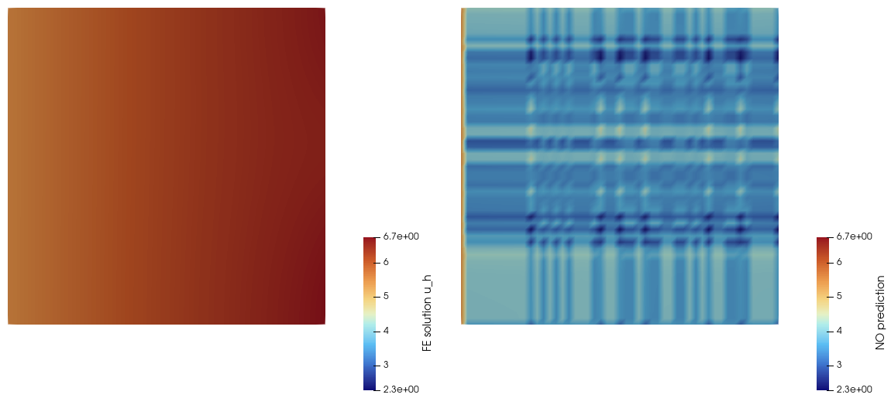

```@meta
EditURL = "../literate/poisson.jl"
```

# Tutorial: a Neural Operator surrogate for a parametric Poisson problem

This tutorial walks through [`test/poisson.jl`](https://github.com/nichomueller/NonlinearROMs.jl/blob/main/test/poisson.jl)
line by line. It is meant for researchers who already know finite elements
and basic deep learning, but have not yet seen how `NonlinearROMs.jl` wires
the two together. By the end you should understand:

- how a *parametric* FE problem is expressed in `GridapROMs.jl` (parameter
  spaces, parameterised coefficients, parametric operators/solvers),
- the vocabulary `NonlinearROMs.jl` uses to turn FE snapshots into training
  data for a neural network (`InputSpace`, `OutputSpace`, `DataFormatter`),
- what a *Kernel Neural Operator* (Kovachki et al.) is, and the two
  different ways this package discretises its non-local integral kernel
  (an FE-quadrature measure vs. a radius graph), and
- the offline/online split (`NeuralSolver` / `neural_operator` / `solve`)
  that mirrors the rest of `GridapROMs.jl`'s reduced-order-modelling API.

The running example is a steady, linear diffusion-reaction-like problem on
the unit square, parameterised by a 3-component parameter ``\mu``:
```math
-\nabla\cdot(a(\mu)\nabla u) = f(\mu) \ \text{in } \Omega, \qquad
u = g(\mu) \ \text{on } \Gamma_D, \qquad
a(\mu)\nabla u\cdot n = h(\mu) \ \text{on } \Gamma_N.
```
We train a network to map ``\mu \mapsto u_h(\mu)`` directly -- a
*non-intrusive* surrogate for the FE solver, as opposed to a classical
(POD/RB-based) reduced-order model.

````@example example
using DrWatson
using Gridap
using GridapROMs
using GridapROMs.RBSteady
using NonlinearROMs
````

## 1. The parameter space

Every parametric quantity is indexed by a [`ParamSpace`](@ref): a box
sampled by a Halton quasi-random strategy by default. Here ``\mu\in\mathbb
R^3`` ranges over ``[1,10]\times[1,10]\times[1,10]``.

````@example example
pdomain = (1,10,1,10,1,10)
pspace = ParamSpace(pdomain)
````

## 2. The (parameter-independent) mesh and triangulations

The mesh itself does not depend on ``\mu``, so it is built exactly as in
plain Gridap: a ``50\times 50`` Cartesian grid on ``\Omega=(0,1)^2``,
together with a `Measure` for the volume integrals and a dedicated
`BoundaryTriangulation`/`Measure` pair for the Neumann boundary (tag `8`,
one side of the square).

````@example example
domain = (0,1,0,1)
partition = (50,50)
model = CartesianDiscreteModel(domain,partition)

order = 1
degree = 2*order

Ω = Triangulation(model)
dΩ = Measure(Ω,degree)
Γn = BoundaryTriangulation(model,tags=[8])
dΓn = Measure(Γn,degree)
````

## 3. Parameterised coefficients: `ParamFunction`/`parameterise`

Every coefficient is a closure of the parameter, `μ -> (x -> value)`,
lifted to a batched [`ParamFunction`](@ref) via [`parameterise`](@ref) so
Gridap can assemble the weak form once for an entire batch of parameters
instead of one at a time.

````@example example
a(μ) = x -> exp(-x[1]/sum(μ))
aμ(μ) = parameterise(a,μ)

f(μ) = x -> 1.
fμ(μ) = parameterise(f,μ)

g(μ) = x -> μ[1]*exp(-x[1]/μ[2])
gμ(μ) = parameterise(g,μ)

h(μ) = x -> abs(cos(μ[3]*x[2]))
hμ(μ) = parameterise(h,μ)
````

## 4. The parametric weak form and FE operator

`stiffness`/`rhs` are the usual Gridap weak forms with every coefficient
now parameterised. [`FEDomains`](@ref) just records which triangulation
each residual/Jacobian integral lives on -- bookkeeping `GridapROMs.jl`
uses for hyper-reduction elsewhere, not needed in this tutorial itself.
[`LinearParamFEOperator`](@ref) takes a right-hand side `rhs(μ,v)` instead
of a residual, since a genuinely linear problem has no state `u` to
evaluate one at.

````@example example
stiffness(μ,u,v) = ∫(aμ(μ)*∇(v)⋅∇(u))dΩ
rhs(μ,v) = ∫(fμ(μ)*v)dΩ + ∫(hμ(μ)*v)dΓn

trian_res = (Ω,Γn)
trian_stiffness = (Ω,)
domains = FEDomains(trian_res,trian_stiffness)

reffe = ReferenceFE(lagrangian,Float64,order)
test = TestFESpace(Ω,reffe;conformity=:H1,dirichlet_tags=[1,3,7])
trial = ParamTrialFESpace(test,gμ)

feop = LinearParamFEOperator(rhs,stiffness,pspace,trial,test,domains)
fesolver = LinearFESolver(LUSolver())
````

## 5. Generating FE snapshots

[`realisation`](@ref) draws `nparams` samples as one `Realisation`, and
`solve(fesolver,feop,μ)` returns a single batched `ParamFEFunction`
bundling every sample's solution (not a `Vector` of ordinary
`FEFunction`s). Two disjoint sets are drawn: `μ_train`/`uhμ_train` (50
samples) become the network's training data in §7-9; `μ`/`uhμ` (one
held-out sample) checks the trained surrogate in §10 against a solution it
never saw.

````@example example
μ_train = realisation(pspace;nparams=50)
uhμ_train = solve(fesolver,feop,μ_train)

μ = realisation(pspace;nparams=1)
uhμ = solve(fesolver,feop,μ)
````

## 6. Neural operators

`NonlinearROMs.jl` learns ``\mu\mapsto u_h(\mu)`` as a *neural operator*: a
network trained directly between function spaces rather than between the
coordinates of one fixed grid. Concretely, it maps an input space
``V_{\text{in}}=\text{span}\{x,a(\mu),f(\mu),g(\mu),h(\mu)\}`` of
coordinates and PDE coefficients to an output space
``V_{\text{out}}=\text{span}\{u_h(\mu)\}`` of FE solutions -- exactly the
one input/output pair §7 builds below.

Nothing in that picture actually requires a *single* input/output pair,
though. More generally, training can reconcile several such spaces at
once, ``(V_{\text{in}}^1,\ldots,V_{\text{in}}^m)\to(V_{\text{out}}^1,\ldots,V_{\text{out}}^m)``,
each potentially living on its own mesh or its own point set. This is
exactly what [`join_spaces`](@ref) does across a `MultiFieldFESpace`'s
fields in the [Stokes tutorial](@ref "Tutorial: a Neural Operator surrogate for parametric Stokes flow")
(velocity/pressure, one mesh, different point sets), and what
[`MultiGraphInducedSpace`](@ref) does across genuinely *different* meshes
in the [moving-geometry Poisson tutorial](@ref "Tutorial: towards a Neural Operator on a *moving* geometry (work in progress)")
-- both reduce back to the single-space picture above once their point
sets are reconciled onto one shared axis. This tutorial only ever needs
the simplest case, one mesh and one space, built next.

## 7. From FE snapshots to training tensors

`NonlinearROMs.jl` represents every per-point quantity -- spatial
coordinates, PDE coefficients, solution fields -- as a dense
`(D,N,K)` array (`D` channels/components, `N` evaluation points, `K`
samples/parameters), aliased `AbstractInputData`. This is the common tensor
layout every neural layer in the package consumes and produces.

- [`get_coords`](@ref) retrieves the FE space's *free*, de-duplicated
  evaluation points (masking away repeated coordinates, e.g. the two
  components of a vector-valued dof sharing one node, and excluding
  Dirichlet-only dofs).
- A [`FeatureBundle`](@ref) bundles several `ParamFunction`s (here, all
  four PDE coefficients) that will be concatenated channel-wise into the
  network's fixed per-point input `a(x)`.
- [`InputSpace`](@ref) evaluates that bundle, and the coordinates
  themselves, into two `(D,N,K)` tensors.
- [`OutputSpace`](@ref) does the analogous thing for the *solution*
  `uhμ_train`, evaluated at the same points.

Both `input_space` and `features` are defined as *functions of* `μ`
precisely so the exact same recipe can build the training tensors (from
`μ_train`) and, later, the held-out test tensors (from `μ`) in §10.

````@example example
dir = datadir("poisson")

x = get_coords(test)
features(μ) = FeatureBundle((aμ(μ),fμ(μ),gμ(μ),hμ(μ)))
input_space(μ) = InputSpace(x,features(μ))
output_space = OutputSpace(uhμ_train)
````

## 8. The training loss: an energy norm

[`EnergyLoss`](@ref) wraps a Gram matrix `X` and trains in the (squared)
`X`-induced norm of the error, rather than a plain pointwise MSE.
[`H1Loss`](@ref) builds `X` from `fspace`'s own `(D,N,K)` point layout (a
masked, FE-assembled stiffness form) instead of the raw FE dof numbering --
the same mechanism the Stokes tutorial's `H1L2Loss` needs for its
multi-field, vector-valued problem (see its §3), used here too so loss
construction stays consistent across tutorials. For this scalar, order-1
field the two numberings coincide one-to-one, so `H1Loss(fspace)` is simply
the ``H^1_0`` stiffness energy natural to this elliptic problem.

````@example example
fspace = FunctionSpace(test)
loss = H1Loss(fspace)
````

## 9. Test 1 -- a Kernel Neural Operator discretised on the FE mesh

A [`KernelNeuralModel`](@ref) implements the iterative kernel-integral
architecture of Kovachki et al.,
```math
v_{t+1}(x) = \sigma\big(W v_t(x) + b(x) + (K_t v_t)(x)\big), \qquad
(K_t v)(x) = \int \kappa_\theta(x,y,\ldots)\,v(y)\,\mathrm dy,
```
built as a `Lux.Chain` of
1. a pointwise **Lift** (`Dense`) from the input channels to the first
   hidden width,
2. one [`KernelNeuralLayer`](@ref) *per interior transition* of
   `hidden_layers` (here `hidden_layers=(16,16)` has only one such
   transition, so there is exactly **one** non-local layer),
3. a pointwise **Project** (`Dense`) down to the output dimension.

What makes a layer "non-local" is how the integral ``(K_t v)(x)`` is
discretised, i.e. the [`InducedMeasure`](@ref) passed through `style`.
[`FunctionSpace`](@ref) wraps an existing Gridap `FESpace`/triangulation;
[`InducedMeasure`](@ref) then builds its weights from the FE *mass matrix*
``M_{ij}=\int \phi_i\phi_j\,\mathrm d\Omega`` (via
`compute_weights(::FunctionSpace{<:FESpace})`), so ``(K_t v)(x)`` becomes a
sparse matrix-vector product with `M` -- a discretisation entirely implied
by the FE mesh you already have, no extra geometric data structure needed.

Internally, every evaluation of `κ_θ` is fed `(x,a(x))` by default (see
[`DataFormatter`](@ref): `pass_coords=true`, `pass_features=true`,
`pass_new_data=false` unless requested); `kv`/`integration` then combine
`κ_θ`'s output with the running hidden state `v` and apply `M`.

[`NeuralSolver`](@ref) bundles the full-order `fesolver` (used purely for
bookkeeping/consistency with the rest of `GridapROMs.jl`'s ROM API) with
the model, loss, optimiser and training schedule.
[`neural_operator`](@ref) runs the **offline phase**: it fetches/normalises
the training tensors and trains the `Lux.Chain` (on a Reactant/XLA device,
with Enzyme-computed gradients), returning a [`NeuralOperator`](@ref) that
bundles the trained weights with the normalisation statistics needed to
run it again later.
`solve(solver,op,input_space(μ))` is the **online phase**: a single forward
pass of the trained network on the held-out parameter `μ`.
[`to_element`](@ref) converts the raw `(D,N,K)` prediction tensor back into
a genuine Gridap `FEFunction` (undoing §7's tensorisation), and
[`visualise`](@ref) writes the true/predicted/error fields to a `.vtu` file
for inspection in ParaView.

````@example example
fmodel = KernelNeuralModel(fspace;hidden_layers=(16,16),activation=tanh)
solver = NeuralSolver(fesolver,fmodel;epochs=200,loss=loss,print_every=50)
op = neural_operator(solver,input_space(μ_train),output_space)
pred_uμ = solve(solver,op,input_space(μ))
pred_uhμ = to_element(OutputSpace(uhμ),pred_uμ)
visualise(dir,uhμ,pred_uhμ;variable_name="uh_gridap")
````

## 10. Test 2 -- the same architecture on a radius graph (GNO)

[`GraphInducedSpace`](@ref) discretises the exact same `KernelNeuralModel`
recipe differently: it builds a [`WeightedSimpleDiGraph`](@ref) by
connecting every pair of points within `radius` of each other (a
`NearestNeighbors.BallTree` radius query), and `(K_t v)(x)` becomes a
graph message-passing step -- gather each edge's source/destination
features ([`gather_data`](@ref)), apply `κ_θ`, and sum ("integrate") into
each destination vertex ([`scatter_data`](@ref)), normalised by in-degree.
This is the classic Graph Neural Operator (GNO) formulation: unlike the FE
mass-matrix measure of §9, it needs no underlying FE space at all, only a
point cloud and a radius, which is why the same machinery scales to the
multi-mesh case of §6/the moving-geometry Poisson tutorial.

Everything else -- the loss, the training loop, the online solve, the
visualisation -- is identical to §9, swapping only `fspace` for `gspace`.
This symmetry (model/solver code oblivious to *which* `InducedMeasure`
backs the kernel) is the point of the `KernelStyle`/`InducedMeasure`
abstraction.

````@example example
mesh_size = 1/50
gspace = GraphInducedSpace(test;radius=2*mesh_size)
gmodel = KernelNeuralModel(gspace;hidden_layers=(16,16),activation=tanh)
solver = NeuralSolver(fesolver,gmodel;epochs=200,loss=loss,print_every=50)
op = neural_operator(solver,input_space(μ_train),output_space)
pred_uμ = solve(solver,op,input_space(μ))
pred_uhμ = to_element(OutputSpace(uhμ),pred_uμ)
visualise(dir,uhμ,pred_uhμ;variable_name="uh_gno")
````

## 11. Inspecting the result

Opening `datadir("poisson")/plot/uh_gridap.vtu` (or `uh_gno.vtu`) in
ParaView shows three fields per parameter sample: the true FE solution
(`uh_gridap_param_1`), the network's prediction (`approx_uh_gridap_param_1`),
and their difference (`err_uh_gridap_param_1`). Rendered directly from that
`.vtu` file, on a shared colour scale:



---

*This page was generated using [Literate.jl](https://github.com/fredrikekre/Literate.jl).*

