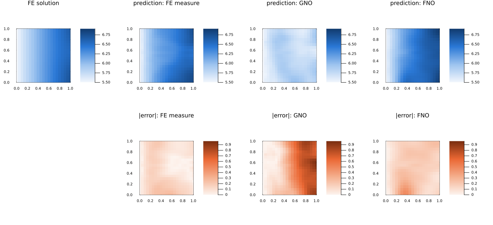
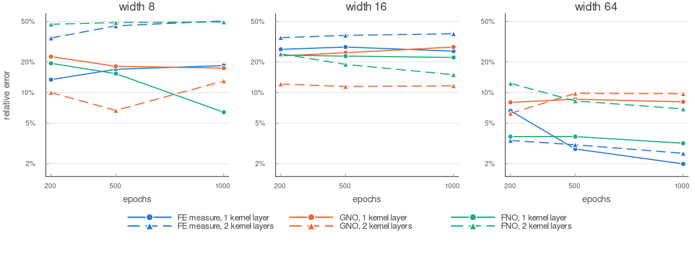
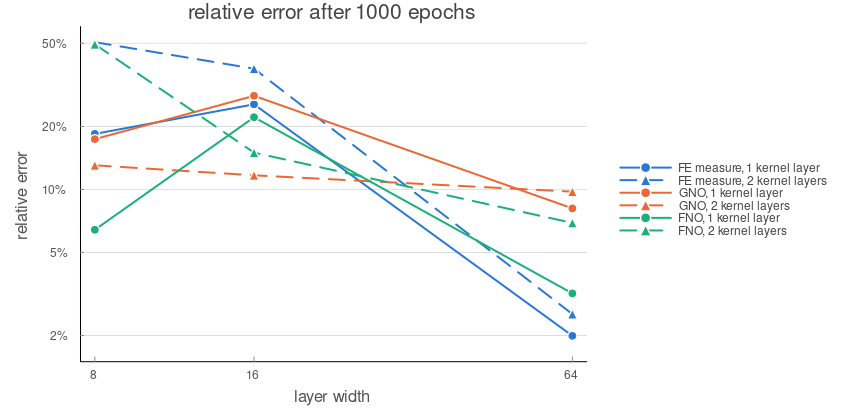
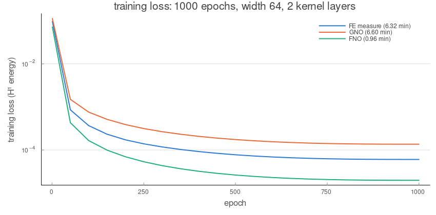

# Preliminary results: Poisson equation

This page reports a parameter sweep on the parametric Poisson problem of the
[Poisson tutorial](@ref "Tutorial: a Neural Operator surrogate for a parametric Poisson problem"),
run with [`test/poisson.jl`](https://github.com/nichomueller/NonlinearROMs.jl/blob/main/test/poisson.jl).
The sweep compares the three ways this package discretises the kernel operator,
and shows how the accuracy depends on the number of epochs, the layer width, and
the number of kernel layers.

## Setup

- **Problem:** the diffusion problem of the tutorial on ``(0,1)^2``, with a
  ``20\times 20`` Cartesian mesh and order-1 Lagrangian elements. The parameter
  ``\mu\in[1,10]^3`` enters the diffusion coefficient, the Dirichlet datum and
  the Neumann datum.
- **Data:** 50 training parameters and one test parameter that is not used in
  training.
- **Operators**, all [`KernelNeuralModel`](@ref)s with `tanh` activations,
  trained on the ``H^1`` [`EnergyLoss`](@ref):
  - **FE measure:** the integral kernel discretised by FE quadrature on the
    mesh ([`FunctionSpace`](@ref));
  - **GNO:** the integral kernel discretised on a radius graph with radius
    ``2h`` ([`GraphInducedSpace`](@ref));
  - **FNO:** a spectral kernel keeping 12 Fourier modes ([`FourierStyle`](@ref)).
- **Sweep:**
  - epochs ``\in \{200, 500, 1000\}``;
  - layer width ``\in \{8, 16, 64\}``;
  - `hidden_layers` of length 2 or 3, i.e. **1 or 2 kernel layers** between the
    lift and the projection.

  That makes 18 configurations per operator, 54 runs in total.
- **Error measure:** the relative nodal ``\ell^2`` error
  ``\|u_h - \hat u_h\|/\|u_h\|`` on the test parameter, computed from the
  `.vtu` files written by [`visualise`](@ref).

!!! warning "How to read these numbers"
    Each configuration was trained once, with a single random seed, and
    evaluated on a single test parameter. Differences of a few percent between
    neighbouring configurations are within the run-to-run variation one should
    expect, and only the larger trends below should be read as significant.

## Best results

| Operator | Best configuration | Relative ``\ell^2`` error | Relative max error |
|:---|:---|---:|---:|
| FE measure | 1000 epochs, width 64, 1 kernel layer | **2.0%** | 4.3% |
| FNO | 1000 epochs, width 64, 1 kernel layer | 3.2% | 7.4% |
| GNO | 200 epochs, width 64, 2 kernel layers | 6.3% | 12.3% |

The fields below come from the 1000-epoch, width-64, 1-kernel-layer runs of each
operator. The top row shows the FE solution and the three predictions, all
on the same colour scale. The bottom row shows the pointwise error, also on a
common scale.

The FE-measure and FNO predictions reproduce the solution almost everywhere. The
GNO prediction has the right range at the left boundary but misses the increase
towards ``x = 1``. Its error is concentrated on the right half of the domain,
where it reaches about 14% of the solution's maximum.

## Effect of the number of epochs

- **At width 64, more epochs help the FE-measure and FNO operators.** The
  FE-measure operator with one kernel layer goes from 6.6% to 2.8% to 2.0%; the
  FNO with one kernel layer goes from 3.7% to 3.2%. The GNO does not improve:
  with one kernel layer it stays at about 8%, and with two kernel layers it
  goes from 6.3% to 9.7%.
- **At widths 8 and 16, more epochs bring no consistent improvement.** Some
  errors decrease, others increase: the FE-measure operator with 2 kernel
  layers and width 8 goes from 34% to 51%. These networks are limited by their
  capacity rather than by the training time, so training longer mainly fits the
  50 training samples more closely.

## Effect of the layer width

The width is the dominant parameter.

- **Width 64 gives the best result for every operator.** After 1000 epochs,
  all six width-64 runs are below 10%, against 6–51% at widths 8 and 16.
- **The improvement is not monotone.** Width 16 is often no better than width 8,
  and sometimes worse (e.g. the FE-measure operator with one kernel layer: 18%
  at width 8, 26% at width 16, 2.0% at width 64). The clear gain only comes with
  the jump to width 64.

## Effect of the number of kernel layers

A second kernel layer gives no improvement at width 64. After 1000 epochs, the
errors go from 2.0% to 2.5% (FE measure), 3.2% to 6.9% (FNO) and 8.1% to 9.7%
(GNO).

At small widths the operators behave differently:

- **The GNO benefits from depth.** At 1000 epochs its error drops from 17% to
  13% at width 8, and from 28% to 12% at width 16. A plausible reason is that its
  graph only connects points within ``2h``, so each layer only exchanges
  information between neighbouring points, and a second layer doubles the
  distance information can travel.
- **The FE-measure operator and the FNO get worse with depth at width 8,**
  reaching about 50%. Their kernels are already global, so the second layer
  mainly adds parameters that a network this narrow cannot train well.

## Efficiency

Training is cheap even in the most expensive configuration of the sweep:
1000 epochs, width 64, 2 kernel layers.

| Operator | XLA compilation | Training time | Time per epoch | Final training loss |
|:---|---:|---:|---:|---:|
| FE measure | 0.06 min | 6.3 min | 0.38 s | ``6.0\cdot 10^{-5}`` |
| GNO | 0.05 min | 6.6 min | 0.40 s | ``1.4\cdot 10^{-4}`` |
| FNO | 0.03 min | 1.0 min | 0.06 s | ``2.0\cdot 10^{-5}`` |

The XLA compilation through Reactant takes a few seconds and is paid once per
training. After that, the FE-measure operator and the GNO train at about 0.4 s
per epoch, and the FNO at about 0.06 s per epoch. The FNO is about 7 times
faster, because its kernel is a truncated FFT rather than a sum over quadrature
pairs or graph edges. For all three operators, most of the decrease in the loss
happens in the first 200–300 epochs, and the curves have flattened by epoch
1000.

The training loss is not a reliable proxy for the test error. The FNO reaches
the lowest training loss but a higher test error than the FE-measure operator
(6.9% against 2.5% in this configuration), a sign that it fits the training
samples more closely than it generalises. Evaluating a trained operator on a new
parameter is a single forward pass, and its cost is negligible compared with
training.

## Summary

- On this problem the integral kernel discretised by FE quadrature gives the
  most accurate surrogate: 2.0% relative error with 1000 epochs, width 64 and
  one kernel layer.
- The layer width matters most. Width 64 is needed for errors below 10%, while
  the number of epochs only refines a network that is wide enough.
- A second kernel layer only helps the GNO, whose graph is local.
- Training takes minutes even in the most expensive configuration, and the FNO
  trains about 7 times faster than the other two operators.
