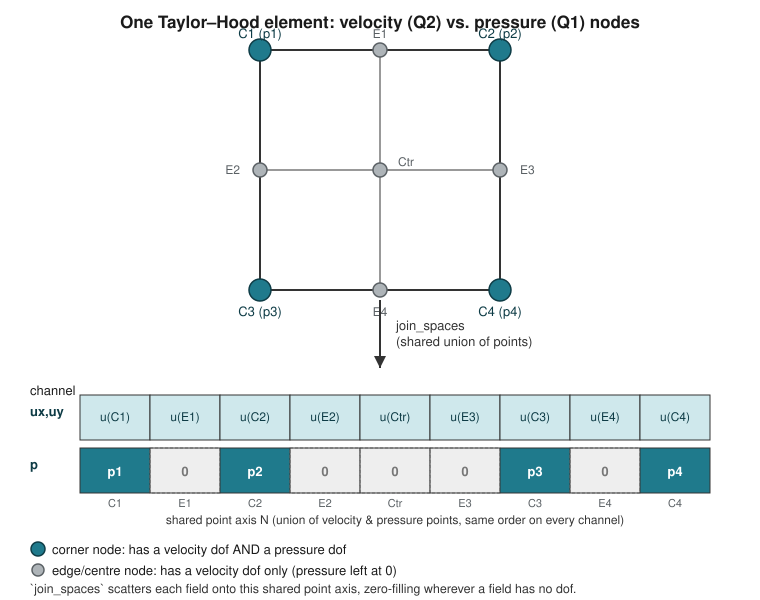

```@meta
EditURL = "../literate/stokes.jl"
```

# Tutorial: a Neural Operator surrogate for parametric Stokes flow

This is a short companion to the
[Poisson tutorial](@ref "Tutorial: a Neural Operator surrogate for a parametric Poisson problem"),
which it assumes you have read: the parameter space, `ParamFunction`/
`parameterise`, `InputSpace`/`OutputSpace`, `KernelNeuralModel`, and the
`FunctionSpace`/`GraphInducedSpace` pair of `InducedMeasure`s are all
unchanged here. This tutorial only calls out what is genuinely different
about a **multi-field, vector-valued** problem: Taylor-Hood Stokes.
```math
-\nabla\cdot(a(\mu)\nabla u) + \nabla p = 0, \qquad \nabla\cdot u = 0
\ \text{in } \Omega, \qquad u = g(\mu) \ \text{on } \Gamma_D.
```
`u` (velocity, quadratic) and `p` (pressure, linear) are the two fields; the
parameter ``\mu\in\mathbb R^3`` controls the viscosity-like coefficient
`a(μ)` and the inflow profile `g(μ)`.

````@example stokes
using DrWatson
using Gridap
using GridapROMs
using GridapROMs.RBSteady
using Lux
using NonlinearROMs

pdomain = (1,10,-1,5,1,2)
pspace = ParamSpace(pdomain)

domain = (0,1,0,1)
partition = (8,8)
model = CartesianDiscreteModel(domain,partition)

order = 2
degree = 2*order

Ω = Triangulation(model)
dΩ = Measure(Ω,degree)

a(μ) = x -> μ[1]*exp(-x[1])
aμ(μ) = parameterise(a,μ)

f(x) = VectorValue(0.0,0.0)

g(μ) = x -> VectorValue(-(μ[2]*x[2]+μ[3])*x[2]*(1.0-x[2]),0.0)*(x[1]==0.0)
gμ(μ) = parameterise(g,μ)
````

## 1. A `MultiFieldFESpace` weak form

Nothing here is specific to `NonlinearROMs.jl`: `test`/`trial` are built the
usual Gridap way, as a Taylor-Hood pair (quadratic velocity, linear
pressure) sharing one triangulation, and `stiffness`/`rhs` are the standard
saddle-point weak form -- `⊙` is a full (Frobenius) tensor contraction,
needed because `∇(v)` of a *vector-valued* trial function is a 2nd-order
tensor, unlike the scalar Poisson case's `⋅`.

````@example stokes
stiffness(μ,(u,p),(v,q)) = ∫(aμ(μ)*∇(v)⊙∇(u))dΩ - ∫(p*(∇⋅(v)))dΩ + ∫(q*(∇⋅(u)))dΩ
rhs(μ,(v,q)) = ∫(f⋅v)dΩ

reffe_u = ReferenceFE(lagrangian,VectorValue{2,Float64},order)
reffe_p = ReferenceFE(lagrangian,Float64,order-1)
test_u = TestFESpace(Ω,reffe_u;conformity=:H1,dirichlet_tags=[1,2,3,4,5,6,7])
test_p = TestFESpace(Ω,reffe_p;conformity=:H1)
trial_u = ParamTrialFESpace(test_u,gμ)
trial_p = ParamTrialFESpace(test_p)
test = MultiFieldFESpace([test_u,test_p])
trial = MultiFieldFESpace([trial_u,trial_p])

feop = LinearParamFEOperator(rhs,stiffness,pspace,trial,test)
fesolver = LinearFESolver(LUSolver())

μ_train = realisation(pspace;nparams=50)
uhμ_train = solve(fesolver,feop,μ_train)

μ = realisation(pspace;nparams=1)
uhμ = solve(fesolver,feop,μ)
````

## 2. Training tensors for a multi-field problem

[`get_coords`](@ref)`(::MultiFieldFESpace)` is the *union* of each field's
own points: velocity (quadratic) has strictly more of them than pressure
(linear) -- the pressure space's points are a subset of the velocity
space's. [`OutputSpace`](@ref)`(::MultiFieldParamFEFunction)` builds one
`OutputSpace` per field and reconciles them onto that shared union via
[`join_spaces`](@ref) (channels concatenated field-by-field, zero-filled
wherever a field doesn't reach a given point) -- entirely transparent here,
but worth knowing if you inspect `output_space.values` directly.

Concretely, for one Taylor-Hood element: velocity (Q2) has a dof at every
corner, edge-midpoint and centre node, while pressure (Q1) only has one at
the 4 corners. `join_spaces` lays both fields out over the 9-point union,
the velocity channels populated everywhere and the pressure channel
populated only at the corners -- zero elsewhere:



````@example stokes
dir = datadir("stokes")

x = get_coords(test)
features(μ) = FeatureBundle((aμ(μ),gμ(μ)))
input_space(μ) = InputSpace(x,features(μ))
output_space = OutputSpace(uhμ_train)
````

## 3. The training loss: `H1L2Loss`, not `EnergyLoss`

The Poisson tutorial's [`EnergyLoss`](@ref) only works because a scalar,
order-1 FE space has exactly one free dof per evaluation point. That
equivalence breaks for Taylor-Hood: velocity has 2 components per point and
pressure has 1, and the point sets themselves differ in size (§2). Taking
a Gram matrix on dofs and multiplying along the model's *point* axis (as
`EnergyLoss` does) is therefore meaningless here.

[`H1L2Loss`](@ref) sidesteps this by building its Gram matrix directly on
`FunctionSpace`'s own `(D,N,K)` point layout -- summing an ``H^1\times L^2``
form field-by-field via `assemble_mass_stiffness` -- rather than on the raw
FE dof numbering, so it stays well-defined regardless of how many
components or distinct points each field has.

````@example stokes
fspace = FunctionSpace(test)
loss = H1L2Loss(fspace)
````

## 4. Test 1 & 2 -- same two `InducedMeasure`s as the Poisson tutorial

[`FunctionSpace`](@ref)`(test)` and [`GraphInducedSpace`](@ref)`(test)`
both resolve `get_coords(test)`'s multi-field union automatically (§2);
everything downstream -- `KernelNeuralModel`, `NeuralSolver`,
`neural_operator`, `solve`, `to_element`, `visualise` -- is byte-for-byte
the same call pattern as the Poisson tutorial's §8-9, just swapping in
`loss` and the multi-field `fspace`/`gspace`.

````@example stokes
fmodel = KernelNeuralModel(fspace;hidden_layers=(16,16),activation=tanh)
solver = NeuralSolver(fesolver,fmodel;epochs=200,loss=loss,print_every=50)
op = neural_operator(solver,input_space(μ_train),output_space)
pred_uμ = solve(solver,op,input_space(μ))
pred_uhμ = to_element(OutputSpace(uhμ),pred_uμ)
visualise(dir,uhμ,pred_uhμ;variable_name="uh_gridap")

mesh_size = 1/8
gspace = GraphInducedSpace(test;radius=2.4*mesh_size)
gmodel = KernelNeuralModel(gspace;hidden_layers=(16,16),activation=tanh)
solver = NeuralSolver(fesolver,gmodel;epochs=200,loss=loss,print_every=50)
op = neural_operator(solver,input_space(μ_train),output_space)
pred_uμ = solve(solver,op,input_space(μ))
pred_uhμ = to_element(OutputSpace(uhμ),pred_uμ)
visualise(dir,uhμ,pred_uhμ;variable_name="uh_gno")
````

`visualise` writes velocity and pressure as separate `CellField`s into the
same `.vtu` (see [`visualise`](@ref)'s `MultiFieldFEFunction` handling), so
`datadir("stokes")/plot/uh_gridap.vtu` opens in ParaView with both fields'
true/predicted/error triplets at once. The same receptive-field caveat
from the Poisson tutorial's §11 applies unchanged: `hidden_layers=(16,16)`
is one non-local layer, so expect the same qualitative failure mode on this
small a network/epoch budget.

---

*This page was generated using [Literate.jl](https://github.com/fredrikekre/Literate.jl).*

